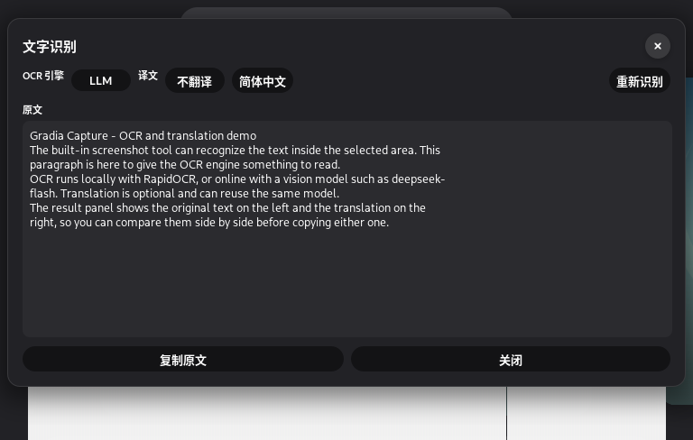
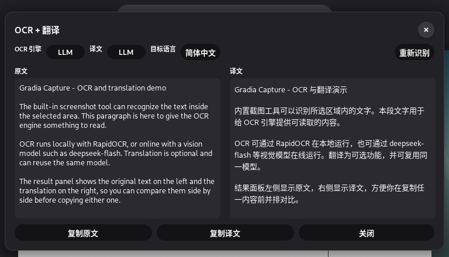

# Gradia Capture（jssd fork）

[English](README.md) | **简体中文**

> 基于 [Alexander Vanhee 的 gradia-capture](https://github.com/AlexanderVanhee/gradia-capture)
> 独立维护的 fork，在保留上游截图标注能力的基础上，增加了本地/在线 OCR、
> 翻译与完整的中文界面。**不是上游官方版本，也不进入上游 PR。**

本仓库的目标：在 Debian 13 + GNOME 48（Wayland）上长期日用，做到
**截图 → 标注 → 识别文字 → 翻译 → 复制/查看** 一条链路可用，界面为简体中文。

## 截图



*仅识别：面板顶部可直接选择 OCR 引擎、翻译引擎与目标语言。*



*OCR + LLM 翻译：原文与译文左右对照，长文本可滚动查看。*

## 功能

### 截图与标注（沿用上游）

- 接管 GNOME 自带截图界面，提供画笔、矩形、实心矩形、高亮、箭头、文字、序号戳等标注；
- 区域/窗口/整屏选择，窗口合成、指针显示、保存格式、音效等选项；
- 保存、复制、在默认应用打开，以及向 [Gradia 应用](https://flathub.org/apps/be.alexandervanhee.gradia) 转发截图。

### OCR 文字识别（fork 专属）

三档引擎，可在首选项中选择，也可在结果面板中随时切换：

| 引擎 | 说明 | 依赖 |
|---|---|---|
| `gradia` | 转发截图给 Gradia flatpak（上游原有行为，默认） | 安装 Gradia 应用 |
| `rapidocr` | 本地识别，可完全离线 | 一次性创建 Python venv |
| `llm` | OpenAI 兼容的多模态模型（如 DeepSeek） | 网络 + API 配置 |

- 触发方式：截图界面按 `Ctrl+E`，或点右下角的扫描按钮；
- 识别期间有 loading 提示，不会默默卡住；
- 失败时给出可操作的通知（未配置、环境缺失、超时、HTTP 错误等）。

### 翻译（fork 专属）

- Google 免 key 翻译（走系统代理即可）；
- LLM 翻译，可**继承 OCR 的 LLM 配置**；当 OCR 与翻译都用 LLM 且开启继承时，
  **一次请求同时返回原文和译文**（一体化）；
- 目标语言可选 12 种（简体/繁体中文、英、日、韩、法、德、西、俄、葡、意、阿）；
- 翻译失败不影响 OCR 结果，原文照常可用，并在面板中提示具体原因。

### 结果面板（fork 专属）

- 屏幕顶部居中，原文与译文**左右并排对比**，内容过长可滚动；
- 面板内直接切换 OCR 引擎、翻译引擎、目标语言，点「重新识别」立即重跑；
- 点「复制原文 / 复制译文」写入剪贴板后，面板自动关闭；
- 纯查看场景不需要复制，剪贴板内容始终按「复制模式」写入。

### 其他

- 全部界面文案走 gettext，简体中文完整翻译；
- 三组独立代理：OCR LLM / 翻译 LLM / Google，各支持 `system` / `direct` / `custom`；
- 首选项按当前配置动态显隐相关项，避免无关设置干扰。

## 系统要求

| 项 | 要求 |
|---|---|
| 桌面 | GNOME Shell 48（在 Debian 13.7 / GNOME 48.7 / Wayland 实测；`shell-version` 保留了 49–51 但未实测） |
| 网络库 | libsoup 3（`gi://Soup?version=3.0`） |
| Python | 仅 RapidOCR 引擎需要：Python 3.13 + `uv`，venv 放在 `~/.local/share/gradia-capture/venv` |
| 其他 | 图标与简体中文翻译资源随扩展打包，无需额外安装 |

## 安装

```bash
git clone https://github.com/jssda/gradia-capture.git
cd gradia-capture
./build.sh -i          # 打包并安装到 ~/.local/share/gnome-shell/extensions/
gnome-extensions info gradia-integration@alexandervanhee.github.io   # 确认 ACTIVE
```

安装后**注销重新登录**（Wayland 下修改 JS 必须重登才会加载新代码）。

### 可选：本地 RapidOCR 环境

```bash
uv venv --python 3.13 ~/.local/share/gradia-capture/venv
uv pip install --python ~/.local/share/gradia-capture/venv/bin/python \
  -i https://pypi.tuna.tsinghua.edu.cn/simple rapidocr onnxruntime
```

安装完成后在首选项里把 OCR 引擎切到 `RapidOCR (local)` 即可断网使用。

## 配置

入口：扩展首选项 → **「OCR 与翻译」**（`gnome-extensions prefs gradia-integration@alexandervanhee.github.io`）。

| 设置组 | 关键项 |
|---|---|
| OCR | 启用 OCR、OCR 引擎 |
| RapidOCR | Python 解释器（留空用默认 venv）、语言、超时 |
| LLM OCR | 启用开关、Base URL、模型、API key 或 key 文件、代理、超时、提示词、附加请求体 |
| 翻译 | 启用、提供方（无/Google/LLM）、目标语言、是否继承 LLM OCR 配置、独立 LLM 配置、Google 代理 |
| 结果 | 复制到剪贴板的内容（仅原文 / 仅译文 / 原文+译文） |

默认值刻意保持“未配置”状态：不预填 Base URL、模型或密钥。

### LLM 配置示例（不预填，仅文档）

- 服务：任意兼容 `POST /chat/completions` 且支持图片输入的模型；
- 示例：Base URL `https://api.deepseek.com`，模型 `deepseek-flash`；
- 思考模式会增加延迟并占用 `max_tokens`，厂商支持时在「附加请求体」传
  `{"thinking": {"type": "disabled"}}` 可关闭；
- API key 建议放在权限 600 的文件里，用「API key 文件」指向它，而不是明文存 dconf。

## 使用

1. 按 `PrtSc` 打开截图界面，选择区域/窗口/整屏并标注；
2. 按 `Ctrl+E`（或点右下角扫描按钮）识别文字；
3. 等待 loading 结束，查看结果面板：
   - 左右对比原文/译文，长的内容滚轮查看；
   - 需要换引擎或语言时，用面板里的下拉框切换后点「重新识别」；
   - 「复制原文 / 复制译文」写入剪贴板并自动关闭面板；
   - 不开翻译时只有原文一栏。
4. 剪贴板内容由「复制模式」决定：`原文`、`译文`、或 `原文 + 空行 + 译文`。

## 项目结构

```text
src/extension.js            扩展入口（少量挂接点）
src/net.js                  网络层：代理会话 + 异步 JSON 请求
src/translate.js            翻译：Google / OpenAI 兼容 LLM
src/ocr/engine.js           编排：OCR → 翻译 → 剪贴板 → 结果面板
src/ocr/llm.js              多模态 LLM OCR
src/ocr/rapidocr.js         本地 RapidOCR 子进程
src/ocr/toast.js            结果面板与识别中提示
src/ocr/languages.js        翻译目标语言列表
src/prefs.js                首选项入口
src/prefs/ocrPage.js        「OCR 与翻译」设置页
python/ocr_helper.py        RapidOCR 命令行助手（打包进扩展）
scripts/ocr-selftest.sh     三档后端对比自测脚本
po/                          gettext 模板与简体中文翻译
docs/PLAN-ocr-translate.md   功能方案、决策记录与分阶段验收
docs/P0-ocr-baseline.md      OCR 引擎基线数据（速度/准确率对比）
docs/RESEARCH-recording-vs-screenshot.md  录屏期间无法截图的调研
```

## 开发与调试

```bash
# 语法检查（GNOME 扩展是 ESM，node 需要 .mjs 后缀）
for f in src/*.js src/ocr/*.js src/prefs/*.js; do cp "$f" /tmp/chk.mjs; node --check /tmp/chk.mjs || echo "FAIL $f"; done

# 三档 OCR 后端自测（gradia / rapidocr / llm）
./scripts/ocr-selftest.sh ~/.local/share/gradia-capture/p0-samples/03-mixed.png

# 打包 / 安装
./build.sh
./build.sh -i

# 日志
journalctl --user -b -o cat /usr/bin/gnome-shell | grep -i gradia
```

调试新代码时如果不方便注销，可以用嵌套会话跑一份新的 shell：

```bash
dbus-run-session -- gnome-shell --nested --wayland
```

## 分支与上游同步

| 分支 | 用途 |
|---|---|
| `master` | 上游镜像，只允许 fast-forward |
| `local` | master + 本地维护提交（GNOME 48 支持、gettext/中文、许可与文档） |
| `gnome-48-support` / `i18n-gettext-zh_CN` | 已提交上游的两个 PR 分支，保持干净 |

同步上游：

```bash
git fetch upstream
git checkout master && git merge --ff-only upstream/master
git checkout local && git rebase master
./build.sh -i
```

上游仍在推进截图界面相关改动，冲突热点是 `src/extension.js`；本项目的改动刻意保持
“新增文件 + 少量挂接点”，便于 rebase。升级 GNOME 或 rebase 后请按
[CHANGELOG.md](CHANGELOG.md) 里的验收清单过一遍。

## 已知限制

- **录屏期间不能截图**：这是 GNOME Shell 的原生限制（录屏时截图界面 `open()` 直接返回），
  不是本扩展引入的；用 OBS/Kooha 等第三方录屏时按源码推断不受影响。详见
  [docs/RESEARCH-recording-vs-screenshot.md](docs/RESEARCH-recording-vs-screenshot.md)。
- **Wayland 下改代码必须重登**，`gnome-extensions disable/enable` 不会重新加载 JS 模块。
- 结果面板是只读的（Shell 内 `St.Entry` 拿不到 fcitx5 候选，见上游 issue #19），不做就地编辑。
- 仅 GNOME 48 实测；`shell-version` 里的 49–51 是沿用上游声明。
- API key 明文存 dconf 不安全，建议使用 key 文件方式。

## 许可与致谢

- 代码基于上游 [gradia-capture](https://github.com/AlexanderVanhee/gradia-capture)，
  沿用 **GPL-3.0-only** 许可，完整文本见 [LICENSE](LICENSE)；
- 上游作者为 Alexander Vanhee，本项目是**非官方 fork**，名称与上游同名仅作来源标识；
- 首选项里的打赏链接与 `metadata.json` 的 donations 仍指向原作者，本 fork 不收款；
- GNOME 行为准则同样适用于本仓库。

## 变更记录

详细的分阶段实现、决策与验收记录见 [CHANGELOG.md](CHANGELOG.md) 与
[docs/PLAN-ocr-translate.md](docs/PLAN-ocr-translate.md)。
